# MyCrobo architecture

One engine, three entry points (`mycrobo scan`, `mycrobo ci`, the GitHub Action), no language plugins.

```mermaid
flowchart LR
    A[Discover files<br/>git ls-files, skip vendored/binary,<br/>detect language] --> B[Rules: 9 deterministic checks<br/>comment/string-aware, any language]
    B --> C[Suppressions<br/>mycrobo-ignore]
    C --> D{--diff BASE?}
    D -- yes --> E[Keep findings on<br/>changed lines only]
    D -- no --> F
    E --> F{AI review?}
    F -- "--ai / --ai-import" --> G[Pick files: findings first,<br/>then input/I-O hotspots]
    G --> H[Prompt: repo conventions profile<br/>+ file with secrets REDACTED<br/>+ candidate findings]
    H --> I[Claude, structured output<br/>or an exported answer]
    I --> J[Verify: evidence must exist in file<br/>security findings can't be dismissed]
    J --> K
    F -- no --> K[Score + sort]
    K --> L[Text / JSON / Markdown / SARIF]
    L --> M[PR review comments + summary<br/>code scanning upload]
```

## Why it works on any codebase

- **No parsers per language.** Rules split each line into code / comment / string using the file's comment syntax (`#`, `//`, `--`, `<!--` …), including multi-line strings, so the same rule runs on Python, TypeScript, Go, Rust, Terraform and YAML.
- **Conventions are discovered, not assumed.** Before the AI review, MyCrobo profiles the repo (languages, logging, error-handling style, validation libraries, test layout) for free and tells the model to judge code against *that* instead of a framework it guesses.
- **Copy-paste detection is token-based.** Normalised line windows are hashed across all files, regardless of language.

## Trust boundaries

| Stage | Guard |
|---|---|
| Sending code to a model | Secrets redacted first; file content is labelled untrusted data |
| Model triage | Security findings can't be dismissed, only marked low-confidence |
| Model findings | Must quote code that really exists in the file; wrong line numbers corrected |
| Cost | `--max-cost` checked before every call; cache for unchanged files |
| GitHub | Inputs only via env vars (tested); least-privilege permissions; comments deduplicated |

## Module map

| Module | Role |
|---|---|
| `discover.py` | file discovery, language detection, test-file detection |
| `text.py` | code / comment / string splitting for any language |
| `rules/` | the 9 deterministic rules |
| `engine.py` | the pipeline above |
| `diff.py` | changed lines vs a git base |
| `ai/` | context + conventions, prompts, Claude client, export/import, verification |
| `score.py` | Slop Score |
| `report.py` | text, JSON, Markdown, SARIF |
| `github.py` | PR review + summary comment |
| `scripts/benchmark.py` | precision / recall against the slop zoo |
